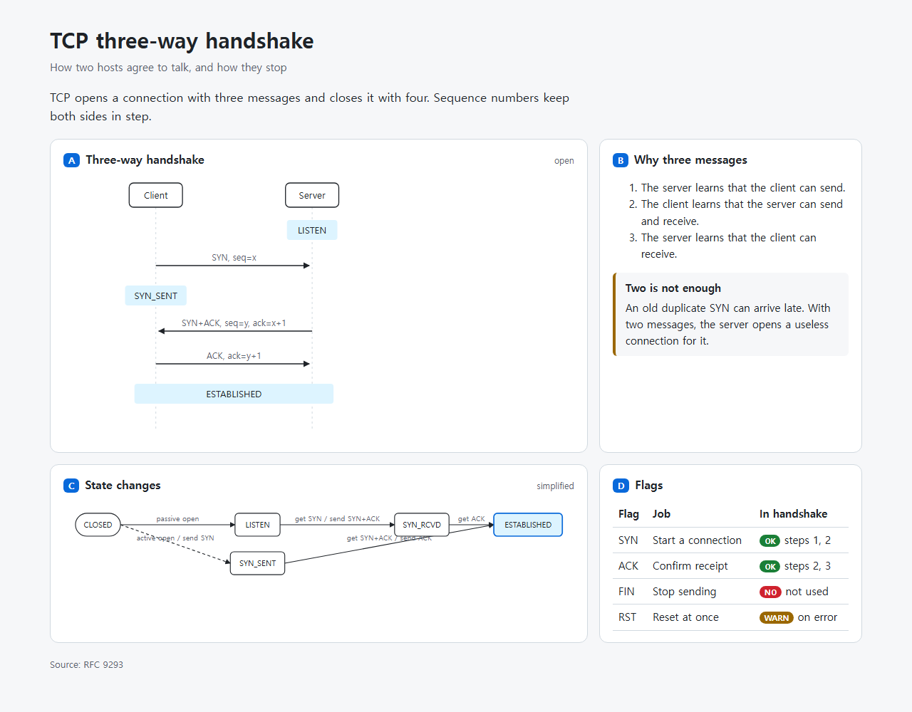
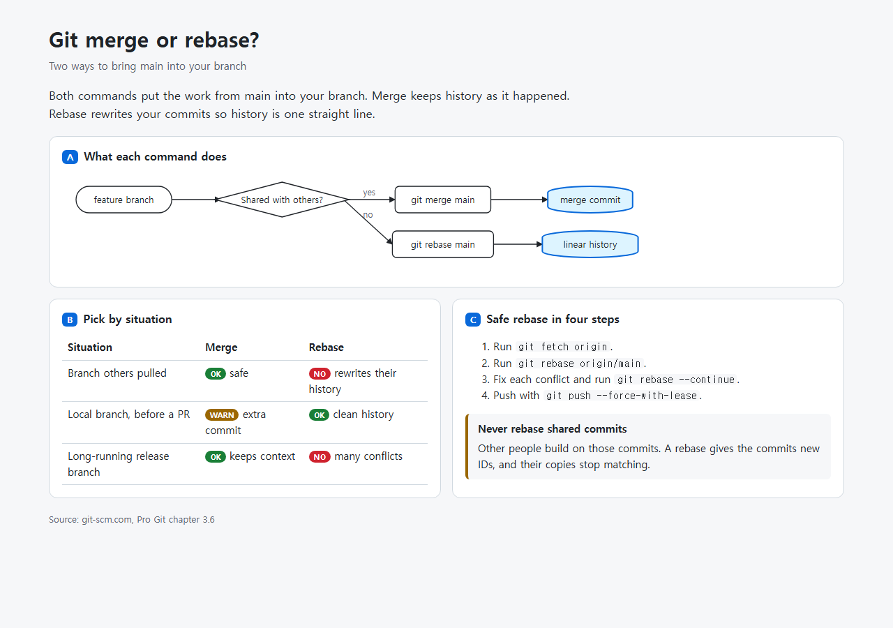

<div align="center">

# answer-page

**Ask your agent a hard question, get one readable page with diagrams instead of a wall of text.**

Karpathy's "understanding ladder" says to pick the lowest rung that works: text, then a diagram, then a page. answer-me-with-html made the page rung popular (4.5k stars). This is the same draft format in one Python file with no npm install.

Works with **Claude Code** and **Codex**.

 



<sub>Real output: <code>python answer_page.py examples/tcp.md</code>, screenshot in Edge. The draft is answer-me-with-html's own TCP example, unchanged.</sub>

</div>

## Quick start
```bash
git clone https://github.com/Dodai0419/answer-page && cd answer-page
python answer_page.py examples/tcp.md -o tcp.html
```
```text
wrote tcp.html: 4 panels, 2 diagrams, 0 style warnings
```
Open `tcp.html` in any browser. It is one file, works offline, and follows your light/dark setting.

## The problem
- Agents answer "explain X" with 60 lines of terminal text. You scroll, lose the thread, and ask again.
- Asking the model to hand-write HTML costs about 8x the tokens (answer-me-with-html's own measurement) and the SVG coordinates are often wrong.
- The popular fix needs Node 20, `npm install` and 103 source files. Many machines where agents run (CI, servers, locked laptops) have Python but no npm.

## The solution
| Idea | Fixes |
|------|-------|
| **The model writes a short Markdown draft; the script draws** (`flow`, `sequence`, status tables, callouts, cards) | No hand-written CSS or SVG coordinates, far fewer output tokens |
| **Same draft format as answer-me-with-html** | Their examples render here unchanged; the skill text carries over |
| **Writing check built in** (sentence length, paragraph length, plain words, passive voice in steps) | Pages that read in one pass, flagged with line numbers |
| **Ladder step** (`--rung auto`) | A two-sentence answer stays text; only structured answers become pages |
| **One Python file, stdlib only** | Runs anywhere Python 3.9+ runs |

## Use with Claude Code
```bash
/plugin marketplace add Dodai0419/answer-page
/plugin install answer-page@answer-page
```
Then ask as usual: *"Explain how our login flow works"*, *"Redis or Memcached for this cache?"*

## Use with Codex (ChatGPT)
```bash
git clone https://github.com/Dodai0419/answer-page && cp -r answer-page/skills/* ~/.codex/skills/
```
Or copy `AGENTS.md` into your project root.

## Gallery

**1. Explain a protocol**: sequence diagram + state flow + flag table ([draft](examples/tcp.md))


**2. Help a decision**: decision flow with a diamond, a comparison table with ok/no/warn chips, safe steps and a warning ([draft](examples/merge-vs-rebase.md))
```bash
python answer_page.py examples/merge-vs-rebase.md
```


**3. Stay on the lowest rung**: a small answer is not turned into a page ([draft](examples/short.md))
```bash
python answer_page.py examples/short.md --rung auto
```
```text
What does HTTP 404 mean?

The server got your request but has nothing at that address. Check the URL for typos. If the link came from another site, the page may have moved.
(rung: text - a page would not add anything here)
```

**4. The writing check** ([draft](tests/fixtures/needs-work.md))
```bash
python answer_page.py tests/fixtures/needs-work.md
```
```text
intro L1 [word] "in order to" -> to
intro L1 [word] "utilize" -> use
A L1 [passive-step] passive voice in a step: "are deleted" -> say who does it
wrote tests/fixtures/needs-work.html: 1 panels, 0 diagrams, 3 style warnings
```
Each warning names the card (`intro`, `A`, `B`, ...) and the line inside it. Add `--strict` to fail CI on warnings.

## Draft cheat sheet
| You write | You get |
|---|---|
| `## A Title {span=2 meta="note"}` | A lettered card, 2 columns wide, with a small note on the right |
| ```` ```flow LR ```` `A -> B: label`, `A --> B`, `A & B -> C`, `(round)`, `{diamond}`, `[(db)]`, `*hot` | Auto-laid-out flow chart |
| ```` ```sequence ```` `participants: A, B`, `A -> B: msg`, `note A, B: text` | Sequence diagram |
| `\| ok text \|`, `\| no text \|`, `\| warn text \|` in a table | Colored status chips |
| ```` ```callout warn Title ```` | Callout box (`ok`, `warn`, `no`, `info`) |

Supported from answer-me-with-html: frontmatter, cards, `flow`, `sequence`, `callout`, tables, lists. Not yet: charts, `tree`, `timeline`, `er`, math, themes, video. Unknown blocks are shown as code.

## Benchmarks
| | answer-me-with-html | this repo |
|-|-|-|
| render `examples/tcp.md` (parse + lint + diagrams + HTML) | not measured | **2.3-3.7 ms** in-process, 389-522 ms cold CLI run |
| source | 12,684 lines in 103 `src/**/*.js` files | 450 lines, 1 file |
| runtime dependencies | Node 20 + 4 npm packages (dagre, marked, temml, fontsource) | none (Python stdlib) |
| output | one HTML file | one HTML file, 5.8-7.2 KB for the examples |

Command: `python bench/bench.py` (50 runs, 3 repeats). Windows 11, Python 3.11.1. The upstream renderer was not executed in this run, so its speed is "not measured"; its line and dependency counts come from its source tree and `package.json`. The upstream renders many more block types (see the cheat sheet), so the line count is not a like-for-like feature comparison.

## Inspired by
- [QingYunA/answer-me-with-html](https://github.com/QingYunA/answer-me-with-html) — the draft format, the `flow` / `sequence` / `callout` syntax, the STE writing rules and word list, and the TCP example (MIT).
- [ChangWenC/understanding-ladder](https://github.com/ChangWenC/understanding-ladder) — "pick the lowest rung that works" (text, diagram, page) (MIT).
- [undefined-ui/explain-skill](https://github.com/undefined-ui/explain-skill) — Karpathy's output ladder as a Claude Code skill, plain-English rules (MIT).

## Roadmap
- [ ] `tree`, `timeline` and bar `chart` blocks.
- [ ] Crossing-reduction for bigger flow charts.
- [ ] `--png` export through a local headless browser.

## License
MIT. Draft format, rules and the TCP example adapted from answer-me-with-html (MIT); see LICENSE.
